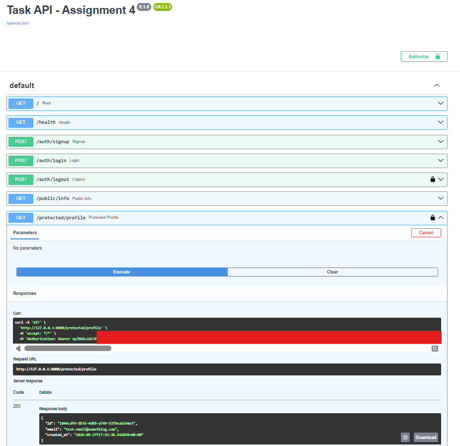

# Task API — Assignment 4: Authentication & Protected Routes

A FastAPI backend secured with **Supabase Authentication**, developed as Assignment 4 of the FlyRank AI Backend Engineering Internship.

## Project Overview

This assignment extends the Task API by adding user authentication and protected routes.

Supabase Auth is used to manage user accounts, passwords, and authentication tokens, while FastAPI verifies the access token before allowing users to access protected resources.

The application supports:

- User signup and login
- Access and refresh tokens
- Public and protected routes
- Bearer token authentication
- Supabase token verification
- Reusable authentication dependency
- Logout
- Swagger UI authentication

## Technologies Used

| Technology | Purpose |
|---|---|
| Python | Backend programming |
| FastAPI | REST API framework |
| Uvicorn | Development server |
| Supabase | Authentication and user management |
| python-dotenv | Environment variable management |
| Swagger UI | API documentation and testing |
| Git & GitHub | Version control and repository hosting |

## Project Structure

```text
task-api/
├── screenshots/
│   └── swagger-auth.png
├── .env
├── .env.example
├── .gitignore
├── main.py
├── requirements.txt
└── README.md
```

### Important Files

- **`main.py`** — FastAPI application, authentication routes, public routes, protected routes, and authentication dependency.
- **`.env`** — Local Supabase configuration. This file is ignored by Git.
- **`.env.example`** — Safe template for the required environment variables.
- **`requirements.txt`** — Python dependencies required to run the application.
- **`screenshots/swagger-auth.png`** — Screenshot showing successful Bearer authentication through Swagger UI.

## Environment Variables

Create a `.env` file in the project root:

```env
SUPABASE_URL=your_project_url
SUPABASE_KEY=your_anon_key
PORT=8000
```

Real credentials are kept locally and are not committed to GitHub.

The repository contains `.env.example` as a safe configuration template.

> The Supabase `service_role` key is not used in this project.

## Installation

Create and activate a virtual environment:

```powershell
python -m venv .venv
.venv\Scripts\Activate.ps1
```

Install the required packages:

```powershell
pip install -r requirements.txt
```

Create the `.env` file using your Supabase project URL and anon key.

## Running the Application

Start the server:

```powershell
uvicorn main:app --reload --port 8000
```

The API will be available at:

```text
http://127.0.0.1:8000
```

Swagger documentation:

```text
http://127.0.0.1:8000/docs
```

## API Endpoints

| Method | Endpoint | Authentication | Description |
|---|---|---|---|
| GET | `/` | Public | Basic API information |
| GET | `/health` | Public | Health check |
| POST | `/auth/signup` | Public | Create a new user |
| POST | `/auth/login` | Public | Login and receive tokens |
| POST | `/auth/logout` | Bearer Token | Logout authenticated user |
| GET | `/public/info` | Public | Public information |
| GET | `/protected/profile` | Bearer Token | Get authenticated user information |
| GET | `/protected/dashboard` | Bearer Token | Access protected dashboard |

## Authentication Flow

### 1. Signup

A user creates an account through:

```text
POST /auth/signup
```

Supabase manages the user account and authentication details.

### 2. Login

The user logs in through:

```text
POST /auth/login
```

A successful login returns an access token and refresh token.

### 3. Access Protected Routes

The access token is sent using:

```text
Authorization: Bearer <access_token>
```

### 4. Token Verification

The reusable `get_current_user()` dependency extracts the Bearer token and verifies it with Supabase.

If the token is valid, the authenticated user is passed to the protected route.

Invalid or expired tokens are rejected with an authentication error.

## Protected Routes

### `/protected/profile`

Returns authenticated user information such as:

```json
{
  "id": "user-id",
  "email": "user@email.com",
  "created_at": "..."
}
```

### `/protected/dashboard`

Demonstrates that the same reusable authentication dependency can protect multiple routes.

### `/auth/logout`

Requires authentication and performs the logout operation for the authenticated user.

## Swagger UI

Swagger UI provides interactive documentation and testing for the API.

The FastAPI `HTTPBearer` security scheme allows protected endpoints to display a lock icon and use the **Authorize** button.

To test a protected route:

1. Login through `/auth/login`.
2. Copy the access token.
3. Click **Authorize** in Swagger.
4. Enter the access token.
5. Execute `/protected/profile`.

Swagger then automatically sends the Bearer token with the request.

### Swagger Authentication Screenshot



## Security

The project follows these security practices:

- Authentication is handled by Supabase.
- Access tokens are verified before protected resources are accessed.
- Protected routes require Bearer authentication.
- `.env` is excluded from Git using `.gitignore`.
- `.env.example` is provided instead of real credentials.
- The Supabase `service_role` key is not used.
- Real credentials and authentication tokens should never be committed to the repository.

## Development Stages

The project was completed incrementally:

- **Stage 0:** Setup FastAPI server and Supabase client
- **Stage 1:** Signup and login routes
- **Stage 2:** Public and initially protected routes
- **Stage 3:** Supabase access-token verification
- **Stage 4:** Reusable authentication dependency, dashboard, and logout
- **Stage 5:** Swagger UI Bearer authentication and screenshot
- **Stage 6:** Documentation, GitHub publication, and final verification

## Final Result

Assignment 4 adds a complete authentication layer to the Task API using Supabase Auth.

The final API supports user registration, login, token-based authentication, protected routes, token verification, logout, Swagger authentication, and secure environment-variable configuration.